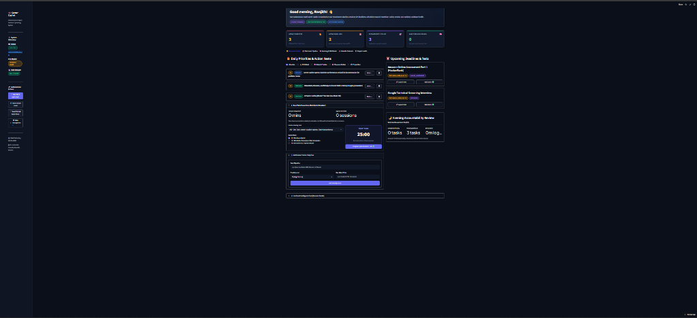
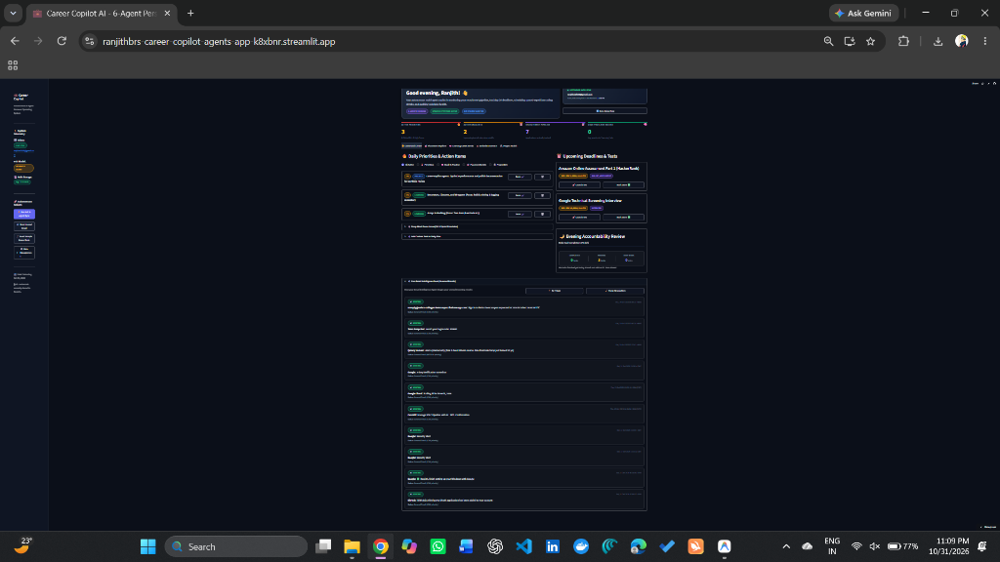
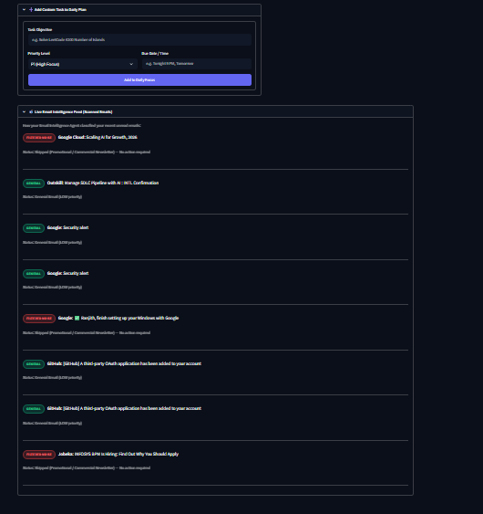
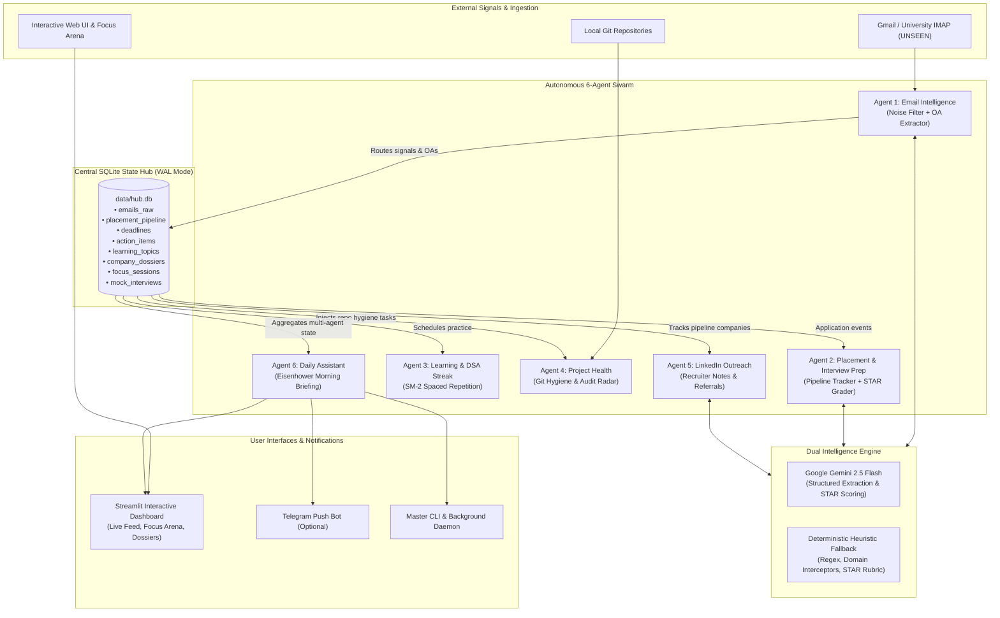

# 🚀 Career Copilot Multi-Agent System

[](https://ranjithbrs-career-copilot-agents-app-k8xbnr.streamlit.app)
[](https://www.python.org/downloads/)
[](https://www.sqlite.org/wal.html)
[](https://ai.google.dev/)
[-success.svg)](./tests)

An autonomous 6-agent personal operating system designed for software engineers, students, and job seekers. It eliminates the cognitive overload of job applications, online assessments (OAs), technical interview preparation, spaced-repetition coding, and git hygiene by coordinating six specialized AI agents through a resilient SQLite Write-Ahead Logging (WAL) shared-memory hub.

🌐 **Live Deployed App:** [ranjithbrs-career-copilot-agents-app-k8xbnr.streamlit.app](https://ranjithbrs-career-copilot-agents-app-k8xbnr.streamlit.app)

---

## 📸 Dashboard Preview

| **Command Center & Real-Time KPIs** |
|:---:|
|  |

| **Full Autonomous Dashboard Overview** | **Inbox Intelligence & Noise Filter** |
|:---:|:---:|
|  |  |

---

## 🏛️ System Architecture

The Career Copilot operates as a decoupled, multi-agent network where all agents communicate through a shared SQLite database running in **WAL (Write-Ahead Logging)** mode for high-concurrency read/write operations.



---

## 🤖 The 6 Autonomous Agents: Responsibilities & Workflows

### 1. 📩 Email Intelligence Agent (`agents/email_intel/`)
* **Core Responsibility:** Eliminates manual inbox anxiety by scanning unread emails, aggressively filtering promotional newsletters, and isolating mission-critical career signals (Online Assessments, Interview Invites, Offer Letters).
* **Inputs:** Live IMAP (`imap.gmail.com:993`) or simulated mock mail batches.
* **Noise Filter:** Domain-level interceptor automatically suppresses and categorizes high-volume digests (`medium.com`, `quora.com`, `substack.com`, Google promotional newsletters) as `NEWSLETTER_SPAM`.
* **Outputs:** 
  * Inserts raw metadata into `emails_raw`.
  * Extracts test links and cutoffs into `deadlines`.
  * Automatically creates application records in `placement_pipeline` (with duplicate company suppression).
  * Injects urgent tasks into `action_items` (`P0` for deadlines < 48h).
* **Resilience Fallback:** If Gemini API rate limits (HTTP 429) or times out, the built-in deterministic heuristic engine takes over using regex-based extraction and keyword confidence scoring.

### 2. 🎯 Placement Pipeline & Interview Prep Agent (`agents/placement/`)
* **Core Responsibility:** Tracks company recruitment funnels (*Applied ➡️ OA Pending ➡️ Interview Scheduled ➡️ Offer*) and provides personalized interview dossiers and STAR-method mock interview evaluations.
* **Tailored Dossiers:** Automatically seeds curated high-yield DSA patterns (e.g., Grids/DP for Amazon, Trees/Concurrency for Microsoft, Graphs/Tries for Google) and company leadership principles.
* **AI Mock Interview Arena:** Evaluates user behavioral answers using the **STAR rubric** (Situation, Task, Action, Result) with quantitative scoring (1–10), strengths, areas for improvement, and a polished rewrite.
* **Resilience Fallback:** Includes curated architectural dossiers and a deterministic rule-based STAR scoring engine that evaluates metric presence, action verbs, and situational context without needing active API tokens.

### 3. 🧠 Learning & DSA Streak Agent (`agents/learning/`)
* **Core Responsibility:** Prevents interview skill atrophy using an algorithmic **Spaced Repetition Engine (SuperMemo SM-2)** across Data Structures & Algorithms, Python internals, and SQL query design.
* **Inputs:** Daily practice problem logs with difficulty ratings (1–5 confidence).
* **Workflow:** Calculates optimal revision intervals and ease factors ($EF$), updating next review dates dynamically:
  $$EF' = EF + (0.1 - (5 - q) \times (0.08 + (5 - q) \times 0.02))$$
* **Outputs:** Automatically injects high-priority review items into `action_items` when topics are due for review.

### 4. 🛠️ Project Health & Git Hygiene Agent (`agents/project/`)
* **Core Responsibility:** Keeps engineering portfolios active and production-ready by auditing local git repository status, commit frequency, and documentation hygiene.
* **Audit Radar:**
  * Checks for README and automated test suites (`pytest`).
  * Scans commit age and flags projects as **stalled** if no commits exist within 7 days.
  * Detects uncommitted changes and TODO comments.
  * Calculates an overall **Git Hygiene Score (0–100%)**.
* **Outputs:** Injects portfolio polish and bugfix tasks into `action_items`.

### 5. 🤝 LinkedIn & Networking Agent (`agents/linkedin/`)
* **Core Responsibility:** Generates professional outreach communications tailored to open job opportunities.
* **Capabilities:**
  * **Recruiter InMail Notes:** Strictly constrained under LinkedIn's free connection limit of **300 characters**.
  * **Alumni Referral Letters:** Contextualized referral requests referencing specific Job IDs and university connections.
  * **Build-in-Public Posts:** Formatted milestone updates celebrating technical achievements.
* **Outputs:** Stores generated drafts in `linkedin_drafts` with character count validation.

### 6. ⏰ Daily Assistant & Executive Briefing Agent (`agents/daily_assistant/`)
* **Core Responsibility:** Functions as your personal chief of staff, synthesizing multi-agent state into a unified morning brief and evening review.
* **Eisenhower Prioritization:** Organizes active tasks into `P0 (Urgent/Critical)`, `P1 (High Focus)`, `P2 (Medium)`, and `P3 (Low)`.
* **Deep-Work Focus Arena:** Integrated Pomodoro and OA simulator (25m / 45m / 60m) that logs dedicated focus sessions directly into `focus_sessions`.
* **Evening Accountability:** Summarizes completed vs. pending tasks and logs total minutes spent in focus work.

---

## ⚡ Error Handling & Agent Coordination

In multi-agent systems, unhandled exceptions in one agent must never crash the entire workflow. The `AutonomousOrchestrator` (`daemon.py`) implements strict isolation and coordination:

1. **Agent Fault Isolation:** Every agent invocation (Email Ingest, Placement Dossiers, Spaced Repetition, Git Health, LinkedIn Outreach, Briefing Synthesis) is wrapped in dedicated `try/except` boundaries. If an agent encounters a transient error, the orchestrator logs the warning, records the diagnostic in `results["errors"]`, and continues executing the remaining agents uninterrupted.
2. **Event-Driven Chaining:**
   * Incoming Email with OA signal ➡️ Triggers `PlacementAgent` to generate a company prep dossier.
   * New Application in Pipeline ➡️ Triggers `LinkedInAgent` to draft a recruiter connection note.
   * Due Study Topics ➡️ Triggers `DailyAssistant` to prioritize practice in the morning briefing.
3. **SQLite WAL Concurrency:**
   * Write-Ahead Logging (`PRAGMA journal_mode=WAL;`) allows readers and writers to operate concurrently without read locks.
   * `PRAGMA busy_timeout=5000;` ensures background threads wait up to 5 seconds if a write transaction is in progress, preventing `sqlite3.OperationalError: database is locked`.

---

## 🧪 Comprehensive Automated Test Suite (36 Tests)

The test suite covers independent agent execution, inter-agent coordination, SQLite WAL concurrency, and Gemini API failure resilience with **100% pass rate**:

```powershell
.venv\Scripts\pytest.exe -v
```

### Test Breakdown by Domain

| Test Suite | Tests | Description |
|:---|:---:|:---|
| **`test_agent_coordination.py`** | 8 | Independent agent validation + full 6-agent chain + fault-tolerant degradation |
| **`test_sqlite_persistence.py`** | 5 | WAL journal mode, busy timeouts, rollbacks on crash, multi-thread concurrency |
| **`test_gemini_resilience.py`** | 6 | HTTP 429 RateLimit, 503 Overloaded, Socket Timeouts, Corrupted JSON, STAR fallback |
| **`test_email_intel.py`** | 3 | IMAP mock parsing, signal classification, and deduplication logic |
| **`test_placement_agent.py`** | 2 | Dossier generation, pipeline stage advancement, task injection |
| **`test_learning_agent.py`** | 3 | SM-2 algorithm, curriculum seeding, study session logging, mastery reports |
| **`test_linkedin_agent.py`** | 4 | 300-char recruiter notes, alumni referral drafts, draft persistence |
| **`test_project_agent.py`** | 1 | Git repo hygiene scoring, commit auditing, test presence check |
| **`test_daily_assistant.py`** | 3 | Morning briefing compiler, evening accountability review, custom task injection |
| **`test_daemon.py`** | 1 | Full background autonomous sync loop validation |
| **TOTAL** | **36** | **36 Passed in 9.84s (0 Failures)** |

---

## 🛠️ Installation & Setup Guide

### 1. Clone & Environment Setup
```powershell
git clone https://github.com/ranjithbrs/career-copilot-agents.git
cd career-copilot-agents

# Create and activate virtual environment
python -m venv .venv
.\.venv\Scripts\Activate.ps1

# Install dependencies
pip install -r requirements.txt
```

### 2. Environment Variables (`.env`)
Copy the template and fill in your values:
```powershell
Copy-Item .env.example .env
```

| Variable | Required | Description | Example |
|:---|:---:|:---|:---|
| `GEMINI_API_KEY` | Optional | Google Gemini API key for LLM intelligence (falls back to heuristics if omitted) | `AIzaSy...` |
| `GEMINI_MODEL` | Optional | Gemini model identifier | `gemini-2.5-flash` |
| `EMAIL_HOST` | Optional | IMAP Host for live email scanning | `imap.gmail.com` |
| `EMAIL_PORT` | Optional | IMAP Port (SSL) | `993` |
| `EMAIL_USER` | Optional | Email address for unread mail scans | `yourname@gmail.com` |
| `EMAIL_PASSWORD` | Optional | 16-character Google App Password (not your normal Gmail password) | `abcd efgh ijkl mnop` |
| `TELEGRAM_BOT_TOKEN`| Optional | Telegram Bot API token for mobile push alerts | `123456:ABC-DEF...` |
| `TELEGRAM_CHAT_ID`  | Optional | Telegram target user/channel Chat ID | `987654321` |
| `DB_PATH` | Optional | Central SQLite database path (default: `data/hub.db`) | `./data/hub.db` |

---

## 💻 How to Run

### 1. Launch Interactive Streamlit Dashboard
```powershell
.\.venv\Scripts\streamlit.exe run app.py
```
*Access in browser at:* `http://localhost:8501`

### 2. Autonomous Multi-Agent Daemon (Background Service)
Continuously runs in the background, checking for urgent career emails, running morning briefings at 08:00 AM, and triggering evening accountability reviews at 09:00 PM:
```powershell
python main.py --daemon --poll-interval 900
```

### 3. Single-Shot Full 6-Agent Sync (CLI)
```powershell
python main.py --sync-all
```

### 4. Specialized CLI Commands
```powershell
# Ingest mock test emails and test routing
python main.py --mode mock

# Generate targeted company prep dossier
python main.py --prep-company "Google"

# Advance an application stage
python main.py --advance-stage "Amazon" --stage INTERVIEW_SCHEDULED

# Draft a recruiter connection note under 300 characters
python main.py --draft-outreach "Microsoft" --type recruiter --name "Alex"

# View daily spaced repetition study targets
python main.py --daily-study

# Audit local git repository health
python main.py --audit-project "."

# Run entire 36-test automated test suite
pytest -v
```

---

## ☁️ Deployment on Streamlit Community Cloud

The repository is pre-configured for one-click deployment on **Streamlit Community Cloud**:
1. Fork or push this repository to GitHub.
2. Sign in to [share.streamlit.io](https://share.streamlit.io/).
3. Select your repository, set the branch to `main`, and main file path to `app.py`.
4. Under **Advanced settings ➡️ Secrets**, add:
   ```toml
   GEMINI_API_KEY = "your_gemini_api_key"
   GEMINI_MODEL = "gemini-2.5-flash"
   EMAIL_HOST = "imap.gmail.com"
   EMAIL_PORT = 993
   EMAIL_USER = "your_email@gmail.com"
   EMAIL_PASSWORD = "your_16_char_app_password"
   ```
5. Click **Deploy**!

---

## 📜 License
Built for personal productivity and career advancement. Released under the [MIT License](LICENSE).
